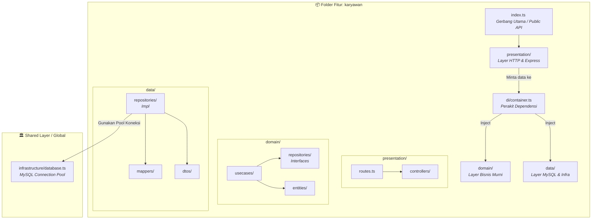
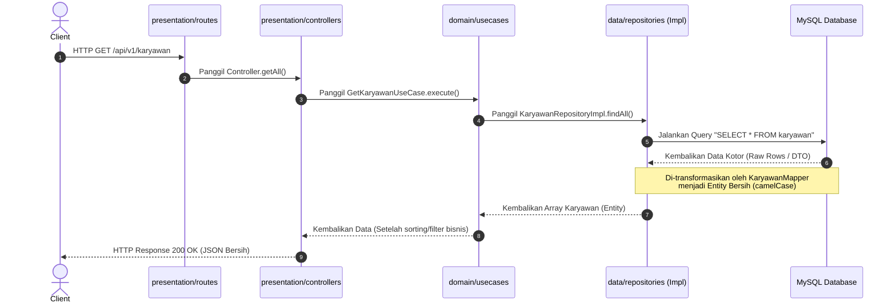
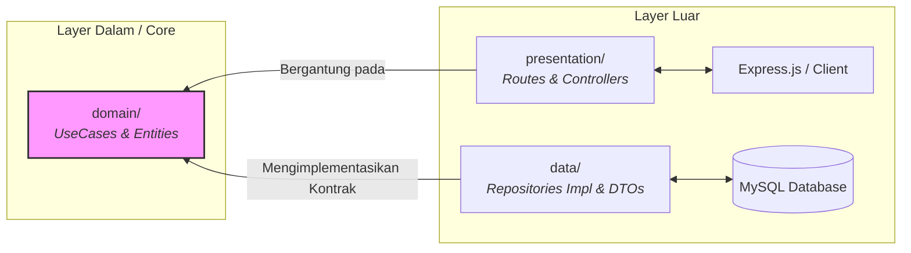
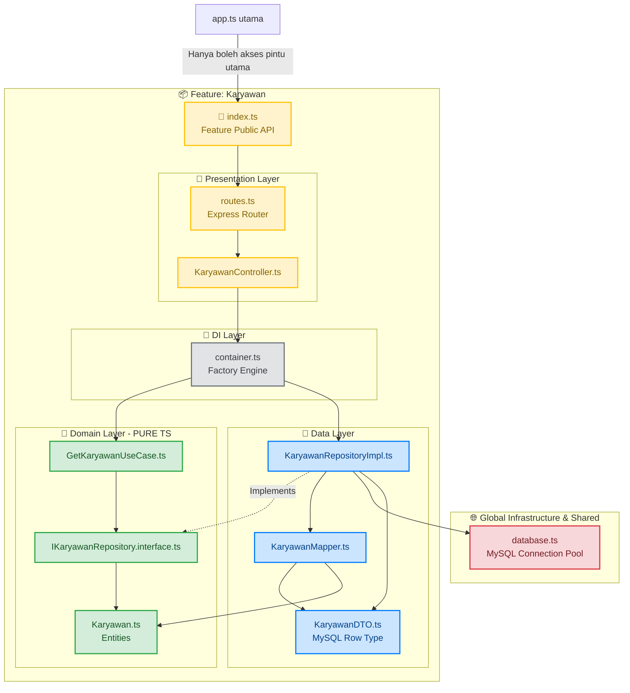
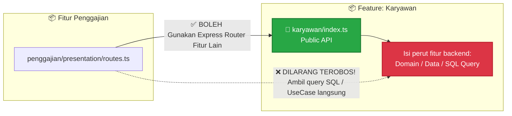

# 📊 Visualisasi Feature-Based Clean Architecture

Berikut adalah diagram visual untuk memahami struktur folder, aliran data, dan aturan ketergantungan pada arsitektur project ini.

---

## 📁 1. Struktur Folder Fitur
Diagram ini menggambarkan bagaimana sebuah fitur (misalnya `karyawan`) mengisolasi seluruh kodenya dan hanya membuka satu pintu keluar melalui file `index.ts`.



---

## 🔄 2. Aliran Data (*Data Flow*)
Diagram ini menggambarkan perjalanan data dari saat *client* melakukan request HTTP ke Express hingga query dieksekusi ke MySQL, lalu dikembalikan dalam bentuk data bersih.



---

## 📐 3. Aturan Ketergantungan (*Dependency Rule*)
Aturan mutlak yang menunjukkan bahwa semua layer luar wajib bergantung dan mengarah ke **Domain Layer (Core)**, sedangkan Domain sama sekali tidak boleh meng-import kode dari luar.



----
# 🏛️ Backend Feature-Based Clean Architecture (Express.js + MySQL)

Dokumen ini merupakan adaptasi dari arsitektur *Feature-Based Clean Architecture* yang diterapkan pada ekosistem Backend Express.js dengan TypeScript dan MySQL. Prinsipnya tetap sama: menjaga agar **Domain Layer tetap suci (terisolasi)** dan memastikan komunikasi antar-fitur terkunci rapat lewat **Public API (`index.ts`)**.

---

## 📁 1. Struktur Folder Fitur (`src/features/karyawan/`)

Setiap fitur membungkus seluruh lapisannya secara mandiri di dalam satu folder. Berikut adalah struktur folder konkretnya:

```text
src/
├── shared/                       # 🌐 Global Infrastructure & Shared
│   └── infrastructure/
│       └── database.ts           # dbPool (Koneksi Pool MySQL global)
│
└── features/
    └── karyawan/                 # 📦 Feature: Karyawan
        ├── index.ts              # 🚪 Feature Public API (Gerbang Utama)
        │
        ├── presentation/         # 🎨 Presentation Layer (Urusan HTTP Express)
        │   ├── controllers/      # KaryawanController.ts (Handler Request & Response)
        │   ├── middlewares/      # KaryawanValidator.ts (Validasi HTTP input)
        │   └── routes.ts         # Router Express khusus fitur karyawan
        │
        ├── di/                   # 🔌 DI Layer (Perakit Objek)
        │   └── container.ts      # KaryawanContainer.ts (Factory Engine)
        │
        ├── domain/               # 🧠 Domain Layer - PURE TS (Otak Bisnis Murni)
        │   ├── entities/         # Karyawan.ts (Struktur data bisnis murni)
        │   ├── repositories/     # IKaryawanRepository.interface.ts (Kontrak data)
        │   └── usecases/         # GetKaryawanUseCase.ts (Logika bisnis spesifik)
        │
        └── data/                 # 💾 Data Layer (Urusan MySQL Database)
            ├── dtos/             # KaryawanDTO.ts (Struktur kolom/baris asli MySQL)
            ├── mappers/          # KaryawanMapper.ts (Pengubah DTO ke Entity)
            └── repositories/     # KaryawanRepositoryImpl.ts (Tempat Query SQL Murni)
```

---

## 📐 2. Diagram Aliran Data & Hubungan Antar-Layer

Diagram ini memvisualisasikan bagaimana kode di dalam fitur `karyawan` saling terhubung. **Domain Layer (Hijau) berada di tengah dan tidak memiliki panah keluar (terisolasi sempurna)**.



---

## 🧱 3. Diagram Komunikasi Antar-Fitur (Cross-Feature Boundaries)

File `index.ts` bertindak sebagai pintu gerbang (*Public API*). Fitur luar (seperti `penggajian`) dilarang keras langsung melakukan *deep import* atau menembak isi perut dari fitur `karyawan`.



---

## 🔍 Cara Membaca Alur Kerja di Backend

1. **`app.ts` Utama / Server:** Hanya mengenal dan meng-import objek router Express yang diekspos secara resmi oleh pintu gerbang `features/karyawan/index.ts`.
2. **Presentation Layer (`KaryawanController`):** Menerima objek request (`req`) dan response (`res`) Express. Ketika butuh mengeksekusi logika bisnis, controller memanggil instansiasi UseCase yang sudah disediakan oleh **DI Layer (`container.ts`)**.
3. **DI Layer (`container.ts`):** Bertindak sebagai pabrik perakitan. Layer ini menggabungkan `KaryawanRepositoryImpl` (Data) ke dalam `GetKaryawanUseCase` (Domain) sehingga Presentation tinggal memakainya dalam bentuk objek jadi.
4. **Data Layer (`KaryawanMapper`):** Bertindak sebagai penyaring. Mengubah data kotor `snake_case` hasil query SQL murni dari database (`KaryawanDTO`) menjadi objek entitas `camelCase` bersih (`Karyawan.ts`) yang dipahami oleh layer Domain.
